# Connect a GitHub repository to ACME.BOT

Connect your GitHub repository, and ACME.BOT will publish each post as a Markdown file through a pull request. To let ACME.BOT in, you create a *personal access token* in GitHub. It works like a password that can only reach the one repository you choose, and only do what you allow. You paste it into ACME.BOT once, and you're set.

- **Time:** about 5 minutes
- **You need:** write access to the repository your site is built from
- **You end up with:** a token that ACME.BOT can use to publish to that repository

## Create a fine-grained personal access token

### 1. Open Fine-grained tokens

In GitHub, go to [Settings → Developer settings → Personal access tokens → Fine-grained tokens](https://github.com/settings/tokens?type=beta) and click **Generate new token**.

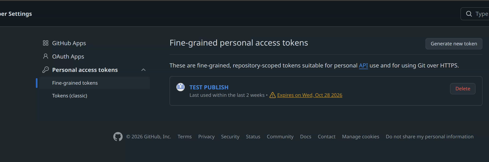

### 2. Name the token and set its owner and expiration

- **Token name:** something you'll recognize later, such as `ACME.BOT publishing`.
- **Resource owner:** the account or organization that owns the repository.
- **Expiration:** how long the token works. GitHub recommends picking a date over **No expiration**. When the date comes, you'll swap in a new token, which takes about two minutes. See [Refreshing your token](#refreshing-your-token).

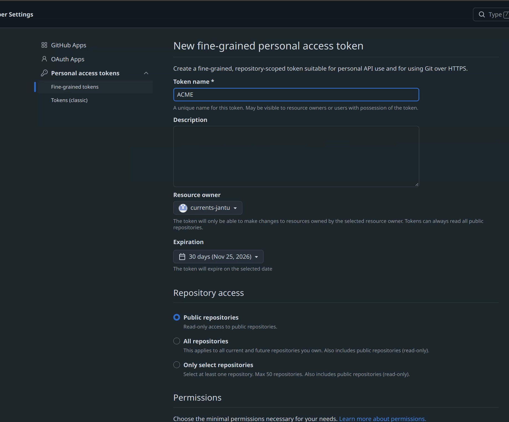

### 3. Choose the repository

Under **Repository access**, choose **Only select repositories**, open **Select repositories**, and pick your site's repository.

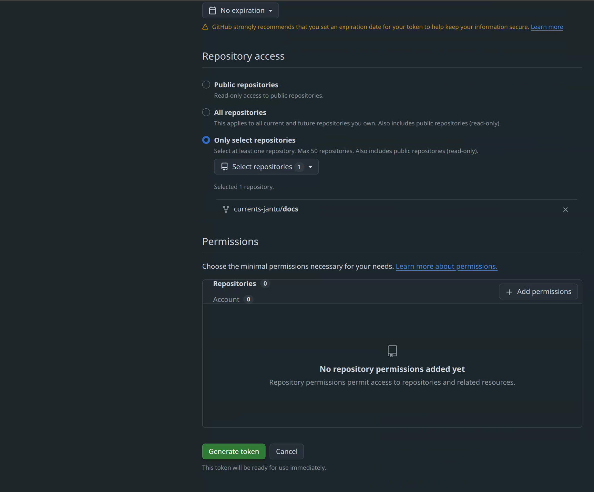

### 4. Set the permissions

Under **Permissions**, click **Add permissions** and add the two below. Then set **Access** to **Read and write** for both:

| Permission | Access |
| --- | --- |
| Contents | Read and write |
| Pull requests | Read and write |

GitHub adds **Metadata: Read-only** by itself, and that's all ACME.BOT needs. Click **Generate token**, then click **Generate token** again in the summary that pops up.

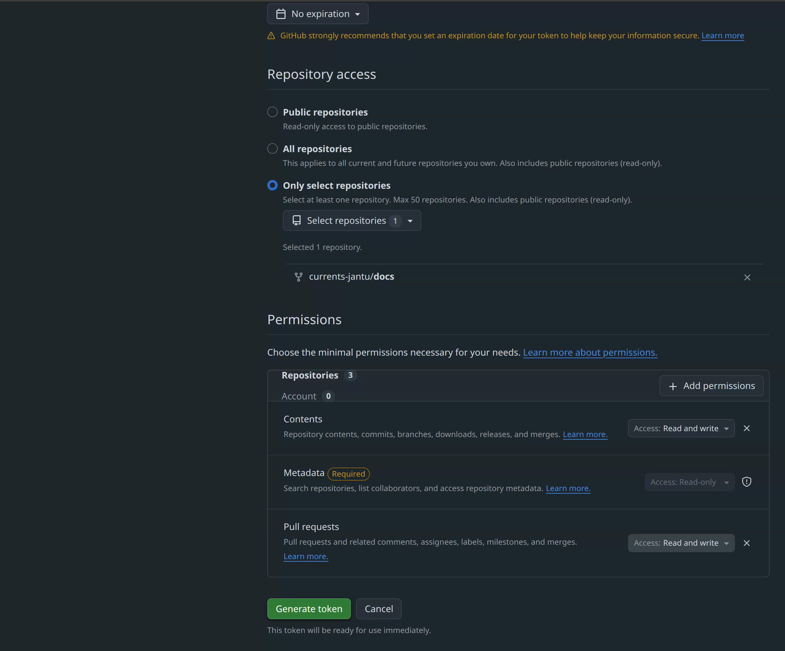

### 5. Copy the token

Your new token appears. It starts with `github_pat_`. Click the copy button next to it now, because GitHub won't show it again.

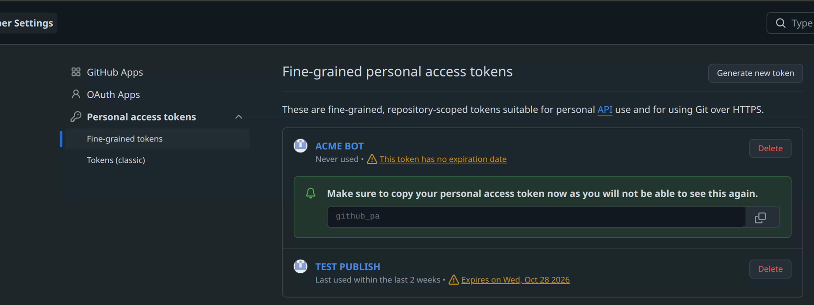

:::caution
Treat the token like a password. Anyone who has it can change your repository. Paste it straight into ACME.BOT, and don't email it or put it in a shared doc.
:::

:::note
If the repository belongs to an organization, an owner of that organization may need to approve your token first. Until they do, GitHub shows it as **Pending** and it won't work yet.
:::

## Add the connector in ACME.BOT

### 6. Open Connectors

In ACME.BOT, click **Connectors** in the left sidebar, then click **Create Connector** at the top right of the **Publish Connector** tab.

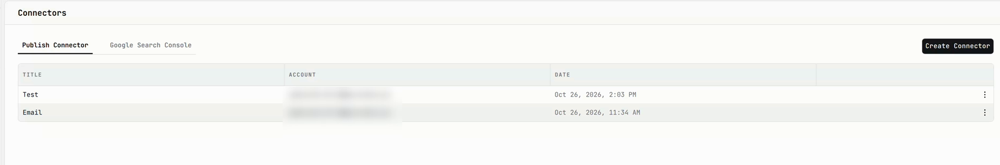

### 7. Choose GitHub

The **Connect Your Blogging Platform** screen opens on **Connector Type**. Choose **GitHub** from the dropdown and click **Next**.

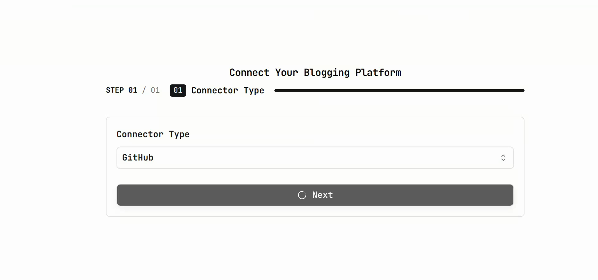

### 8. Paste the token and repository

On **GitHub Auth**, fill in:

| Field | What to enter |
| --- | --- |
| Personal Access Token | The `github_pat_…` value you copied |
| Repository | `owner/repo`, or the repository's GitHub URL |

Click **Authorize**. ACME.BOT makes sure the token can open the repository and write to it.

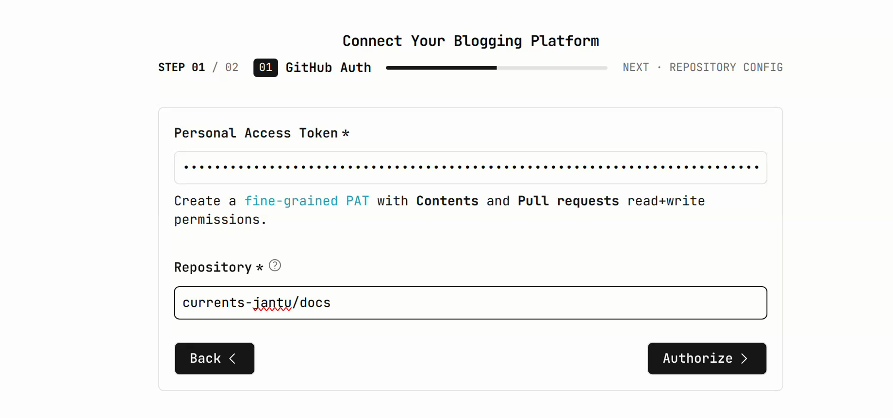

### 9. Configure the repository

On **Repository Config**, set:

- **File Path Pattern:** the folder and file name each post is saved as. The default, `blog/{slug}.md`, saves a post called "My First Post" as `blog/my-first-post.md`. You can also use `{date}`.
- **Frontmatter Template:** the block of details at the top of each file, such as the title, date and summary. Most sites work with the default. Only change it if your site expects different fields.
- **Auto-merge PRs:** on by default. ACME.BOT merges each post's pull request as soon as it opens it, so the post goes live straight away. Untick it if you'd rather review each post on GitHub and merge it yourself. You can change this later (see [Turning auto-merge on or off](#turning-auto-merge-on-or-off)).
- **Connector Name:** any name that helps you spot this connector in the list, such as `GitHub Docs`.

Click **Save Connector**.

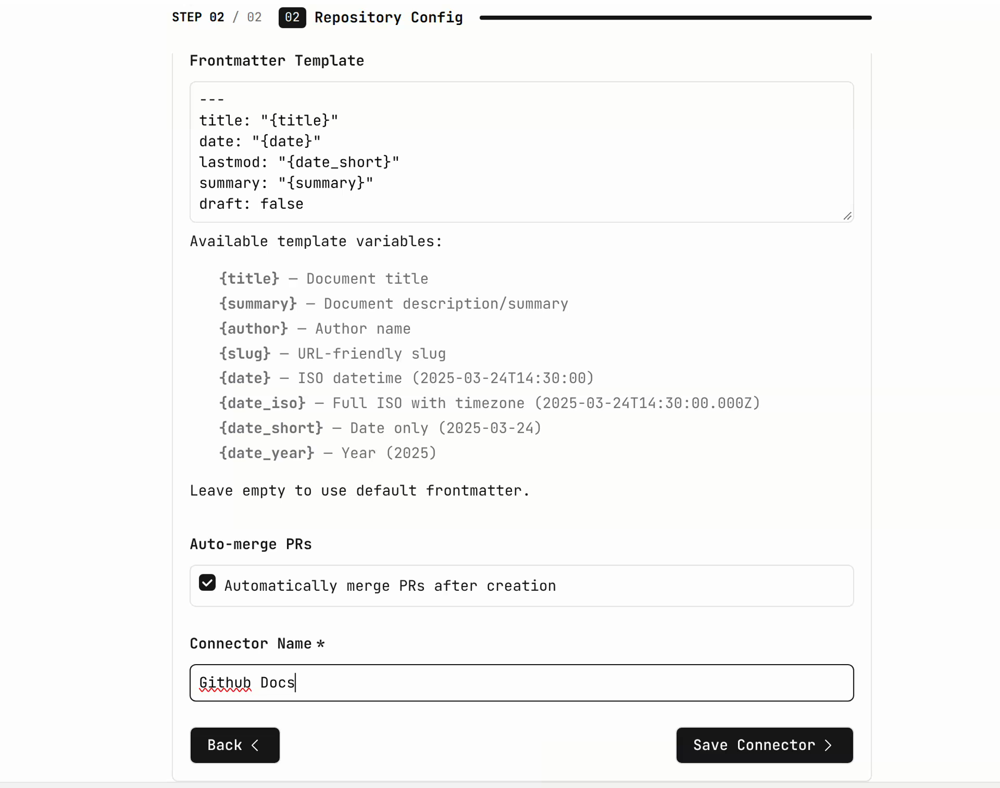

### 10. Confirm the connection

You'll see **Connection Successful!**, and then ACME.BOT takes you back to the Connectors list. Your GitHub connector is there, ready to publish.

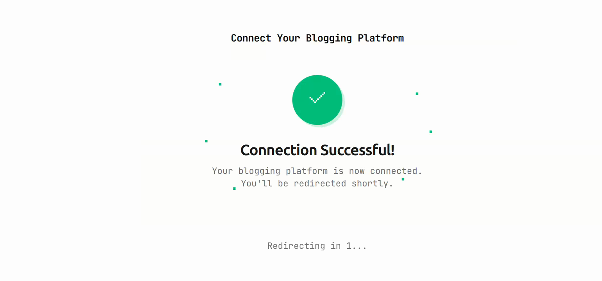

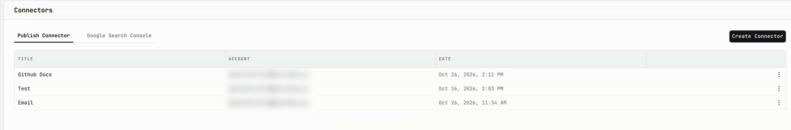

## How auto-merge works

With **Auto-merge PRs** on, ACME.BOT opens a pull request for each post and merges it right away (as a squash merge). The token permissions from step 4 (Contents and Pull requests, read and write) are all it needs.

Some repositories have rules that stop a pull request from being merged straight away:

- **Required status checks** (for example, a build that has to pass): ACME.BOT turns on GitHub's own auto-merge for the pull request instead, and GitHub merges it once the checks pass. This needs **Allow auto-merge** to be on in the repository's **Settings → General → Pull Requests**.
- **Required reviews**: the pull request waits for someone to approve it. If **Allow auto-merge** is on, GitHub merges it after the approval. If not, merge it yourself.
- **Merge conflicts**, or a branch that changed in the meantime: merge it yourself on GitHub.

If a pull request can't be merged, the post is not live yet, and ACME.BOT tells you so in two places:

- **On the pull request:** a comment with GitHub's reason.
- **In ACME.BOT:** the publish result says *"The pull request was opened but could not be merged automatically, so the post is not live yet. GitHub's response: … Merge it by hand to publish: &lt;link&gt;"*.

Merging the pull request on GitHub publishes the post.

## Turning auto-merge on or off

You can change this at any time, without setting up the connector again:

1. In ACME.BOT, click **Connectors** in the left sidebar, then click your GitHub connector in the list.
2. Tick or untick **Auto-merge PRs**.
3. Leave **Personal Access Token** empty to keep your current token.
4. Click **Save**.

The change applies from the next post an agent publishes. Pull requests that are already open are not merged or closed.

## Refreshing your token

If you gave your token an expiration date, it stops working on that date, and ACME.BOT can't publish to GitHub until you give it a new one. ACME.BOT lets you know:

- **Before it expires:** in the last 10 days, each successful publish shows a reminder: *"Your GitHub token expires in N days…"*
- **After it expires:** publishing stops with *"GitHub rejected the connector's token. If publishing worked before, the token has most likely expired…"*

Fixing it takes two steps: get a new token from GitHub, then give it to ACME.BOT.

### 1. Get a new token from GitHub

The quickest way is to regenerate the token you already have:

1. Open [Fine-grained tokens](https://github.com/settings/tokens?type=beta) and click the token you made for ACME.BOT.
2. Click **Regenerate token**, choose a new expiration, and confirm.
3. Copy the new `github_pat_…` value.

The regenerated token keeps the same repository and permissions, so there's nothing else to set. The old one stops working right away. If you deleted the old token, [create a new one](#create-a-fine-grained-personal-access-token) with the same permissions instead.

### 2. Update the connector in ACME.BOT

You don't need to set up the connector again. Just give your existing one the new token:

1. In ACME.BOT, click **Connectors** in the left sidebar, then click your GitHub connector in the list.
2. The **Personal Access Token** field is empty. That's expected: ACME.BOT never shows a saved token again.
3. Paste the new `github_pat_…` value into **Personal Access Token**.
4. Click **Save**. ACME.BOT checks the new token, just as it did when you first connected, and shows when it expires.

Everything else about the connector stays the same. Every agent that uses it switches to the new token from its next publish.

:::tip
Put a reminder in your calendar a few days before the new expiration date. Then you can swap the token before anything fails.
:::

## If the connection is rejected

- **"The token does not have push access to this repository."** The token can read your repository but not change it. In GitHub, edit the token and set **Contents** to **Read and write**.
- **"GitHub refused access to…"** The token is missing a permission. Make sure both **Contents** and **Pull requests** are set to **Read and write**.
- **"GitHub could not find the repository…"** Check the repository name for typos, and make sure the token was given access to it under **Repository access**.
- **The token shows as Pending in GitHub.** An owner of the organization needs to approve it. Ask them, then try again.

GitHub updates its settings pages now and then, so a label here may not match exactly. The steps stay the same: Fine-grained tokens → Generate new token → choose the repository → give Contents and Pull requests read and write access.
